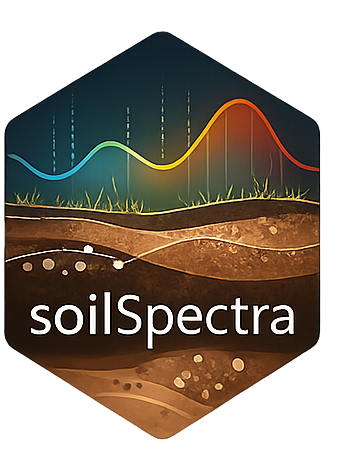

# autoSpectra 

<!-- badges: start -->
[](https://CRAN.R-project.org/package=autoSpectra)
[](https://CRAN.R-project.org/package=autoSpectra)
[](https://github.com/HugoMachadoRodrigues/autoSpectra/releases)
[](LICENSE)
[](https://doi.org/10.5281/zenodo.19004686)
[](https://www.r-project.org/)
[](https://docs.soilspectroscopy.org)
[](https://orcid.org/0000-0002-8070-8126)
[](https://github.com/HugoMachadoRodrigues/autoSpectra/actions/workflows/R-CMD-check.yml)
[](https://HugoMachadoRodrigues.github.io/autoSpectra/)
<!-- badges: end -->

> **Soil spectral modeling, visualization, and prediction** — powered by the Open Soil Spectral Library (OSSL v1.2) and soilVAE asymmetric autoencoders. Two sensor-agnostic models cover the complete VisNIR and MIR spectral ranges with data from any field or laboratory instrument.

---

## Table of Contents

1. [Overview](#overview)
2. [Models](#models)
3. [Sensor-Agnostic Methodology](#sensor-agnostic-methodology)
4. [Supported Instruments](#supported-instruments)
5. [Performance Benchmarks](#performance-benchmarks)
6. [Architecture](#architecture)
7. [Preprocessing Pipeline](#preprocessing-pipeline)
8. [Soil Properties](#soil-properties)
9. [OSSL Data Sources](#ossl-data-sources)
10. [Installation](#installation)
11. [Quick Start](#quick-start)
12. [Shiny Interface](#shiny-interface)
13. [Versioning](#versioning)
14. [Data Citations](#data-citations)
15. [Software Citation](#software-citation)
16. [License](#license)

---

## Overview

**autoSpectra** is an R package and interactive Shiny application for predicting soil physical and chemical properties from diffuse reflectance spectra. It provides **four OSSL-trained model families** — two algorithms × two spectral domains — so the user can pick between a sensor-agnostic deep-learning model and a faithful replication of the [Safanelli et al. (2025)](https://doi.org/10.1371/journal.pone.0296545) reference Cubist+PCA pipeline:

| Model family | Algorithm | Range | Bands | Sensor-agnostic? |
|---|---|---|---|---|
| **OSSL_VisNIR**        | masked soilVAE              | 350–2500 nm    | 1 076 @ 2 nm | yes (any band coverage) |
| **OSSL_MIR**           | masked soilVAE              | 600–4000 cm⁻¹  | 1 701 @ 2 cm⁻¹ | yes (any band coverage) |
| **OSSL_VisNIR_Cubist** | Cubist + PCA(120) + SNV     | 350–2500 nm    | 1 076 @ 2 nm | requires full coverage |
| **OSSL_MIR_Cubist**    | Cubist + PCA(120) + SNV     | 600–4000 cm⁻¹  | 1 701 @ 2 cm⁻¹ | requires full coverage |

All four families were trained on the full [Open Soil Spectral Library v1.2](https://docs.soilspectroscopy.org) using the same SNV preprocessing and the same 10-fold cross-validation strategy described in Safanelli (2025), so the soilVAE numbers are directly comparable to the Cubist baseline.

> **Why two families?** The **Cubist** baseline reproduces the published OSSL methodology — the "ground truth" from the literature. The **masked soilVAE** is our contribution: it accepts spectra from any instrument, including those that only cover a sub-range (e.g., NeoSpectra 1350–2550 nm), via a binary coverage mask channel and `spectral_dropout` augmentation at training time.

---

## Models

### OSSL_VisNIR — masked soilVAE (sensor-agnostic, 350–2500 nm)

```
Family ID  : OSSL_VisNIR
Algorithm  : masked Variational Autoencoder, latent dim = 16
Domain     : Visible + Near-Infrared reflectance
Grid       : 350 – 2500 nm at 2 nm (1 076 bands)
Input      : [SNV-spectrum | binary mask]   shape = 2 * 1076
Pipeline   : -ln(R) -> SG smooth(11,2) -> SNV (per-mask)
Augmentation: spectral_dropout - 3 simulated cut-offs per training sample
              (full ASD / 1000 nm Bruker / 1350 nm NeoSpectra)
Validation : 10-fold CV with refitting (Safanelli 2025)
AD         : Mahalanobis distance in 16-D latent space (chi-squared at alpha=0.05)
```

### OSSL_MIR — masked soilVAE (sensor-agnostic, 600–4000 cm⁻¹)

```
Family ID  : OSSL_MIR
Algorithm  : masked Variational Autoencoder, latent dim = 16
Domain     : Mid-Infrared absorbance (ATR, DRIFTS)
Grid       : 600 - 4000 cm-1 at 2 cm-1 (1 701 bands)
Input      : [SNV-spectrum | binary mask]   shape = 2 * 1701
Pipeline   : SG smooth(11,2) -> SNV (per-mask)
Validation : 10-fold CV with refitting (Safanelli 2025)
AD         : Mahalanobis distance in 16-D latent space
```

### OSSL_VisNIR_Cubist / OSSL_MIR_Cubist — Safanelli 2025 replication

```
Algorithm  : Cubist (committees in {1, 5, 10, 15, 20})
Predictors : First 120 principal components (Safanelli, p. 9)
Preprocess : SNV (Safanelli ring-trial selection, p. 9)
Tuning     : 5-fold inner CV on a 2 000-sample subset (Safanelli, p. 9)
Validation : 10-fold outer CV with refitting (Safanelli, p. 10)
Targets    : log1p transform for skewed properties (Safanelli, p. 10)
AD         : Q-statistic on PCA residuals; UCL_Q via Jackson-Mudholkar 1979
             at 99% confidence (Safanelli eq. 3)
Uncertainty: normalised conformal prediction with delta = f(T120) error model
             at 68% confidence ~ 1 SD (Safanelli eqs. 9-10)
```

---

## Methodology — what we copied from Safanelli (2025) and what we added

The package implements **every key step** of Safanelli et al. (2025) so the Cubist family is a direct replication. The masked soilVAE family then changes only the predictive engine, keeping preprocessing, validation, applicability domain, and uncertainty as comparable as possible.

| Step | Safanelli 2025 (Cubist) | autoSpectra Cubist family | autoSpectra soilVAE family |
|---|---|---|---|
| Spectral range | 350–2500 / 600–4000 | same | same |
| Preprocessing | SNV alone | SNV alone | SG smooth(11,2) → masked SNV |
| Predictor | First 120 PCs | First 120 PCs | 16-D VAE latent |
| Algorithm | Cubist (committees ∈ {1, 5, 10, 15, 20}) | same | masked VAE |
| Inner tuning | 5-fold CV, ~2 000 sample subset | same | none (callbacks only) |
| Outer validation | 10-fold CV with refitting | same | same |
| Target transform | log1p (skewed properties) | same | same |
| Applicability domain | Q-statistic + UCL_Q (99%) | same | Mahalanobis on latent (95%) |
| Uncertainty | Normalised conformal, 68% PI | same | absolute conformal q90/q95 |
| **Sensor-agnostic for partial coverage** | **no** (separate NeoSpectra model) | no | **yes** (mask + dropout) |

The masked soilVAE is the **only family that handles instruments that don't cover the full range** (NeoSpectra 1350–2550 nm, Bruker MPA 800–2500 nm, etc.) without requiring a separate model.

---

## Supported Instruments

Any instrument whose spectral output can be resampled to the canonical OSSL grid is compatible. autoSpectra resamples automatically via linear interpolation.

| Family | Partial coverage (e.g. NeoSpectra 1350-2550 nm) |
|---|---|
| `OSSL_VisNIR` (masked VAE) | works — coverage encoded in mask channel |
| `OSSL_MIR` (masked VAE) | works |
| `OSSL_VisNIR_Cubist` (Safanelli) | requires (350–2500 nm) coverage; otherwise predict but with low-AD warning |
| `OSSL_MIR_Cubist` (Safanelli) | requires (600–4000 cm⁻¹) coverage |

---

## Supported Instruments

Any instrument whose spectral output can be resampled to the canonical OSSL grid is compatible. autoSpectra resamples automatically via linear interpolation.

### VisNIR instruments in OSSL v1.2

| Instrument | Manufacturer | Range (nm) |
|-----------|-------------|-----------|
| FieldSpec 3 / 4 | Malvern Panalytical (ASD) | 350–2500 |
| XDS Rapid Content Analyzer | Foss | 400–2500 |
| MPA FT-NIR | Bruker | 800–2500 |
| Spectrum One FT-NIR | PerkinElmer | 1000–2500 |
| MicroNIR | VIAVI Solutions | 908–1676 |
| Other diffuse-reflectance VisNIR | Various | ≥400 |

### MIR instruments in OSSL v1.2

| Instrument | Manufacturer | Technique | Range (cm⁻¹) |
|-----------|-------------|-----------|-------------|
| ALPHA FTIR | Bruker | ATR (diamond) | 400–4000 |
| Tensor 27 FTIR | Bruker | DRIFTS | 400–4000 |
| Spectrum Two FT-MIR | PerkinElmer | ATR | 400–4000 |
| Nicolet iS10 / iS50 | Thermo Fisher | ATR / DRIFTS | 400–4000 |
| Other FTIR instruments | Various | ATR / DRIFTS | ≥600 |

> **Bringing a new instrument?** Resample your spectra to the model grid (handled automatically by `predict_soil()`), and check the applicability domain score. The Mahalanobis distance will tell you whether the instrument's spectral profile is within the training distribution.

---

## Performance Benchmark — Safanelli (2025) baseline

Safanelli et al. (2025) Tables 4 and 5 report an independent evaluation of the OSSL Cubist + PCA(120) + SNV models across 20 distinct VisNIR / MIR instruments. Those figures are the reference baseline for this package, and are quoted verbatim further down.

**A note on comparing against them.** Their evaluation holds out whole instruments. Any autoSpectra number produced by a random train/test split is measured on an easier problem and is not comparable to it, however favourable it looks. Use the leave-one-dataset-out results for that comparison.

### autoSpectra v0.4.0 — single random 80/20 split

Full training, 60 epochs, all four families. Metrics are test-set values in original units (`log1p` targets are back-transformed before scoring).

| Sensor | Property | soilVAE (R² / RMSE / CCC) | Cubist (R² / RMSE / CCC) | Safanelli (R² / RMSE / CCC) |
|---|---|---|---|---|
| **VisNIR** | oc       | 0.850 / 4.82 / 0.906 | 0.941 / 3.04 / 0.970 | 0.78 / 5.27 / 0.82 |
| **VisNIR** | n.tot    | 0.899 / 0.17 / 0.945 | 0.910 / 0.16 / 0.951 | 0.81 / — / — |
| **VisNIR** | ph.h2o   | 0.866 / 0.50 / 0.924 | 0.864 / 0.50 / 0.928 | 0.50 / 1.22 / 0.65 |
| **VisNIR** | clay.tot | 0.805 / 6.86 / 0.884 | 0.829 / 6.42 / 0.902 | 0.25 / 13.35 / 0.38 |
| **MIR**    | oc       | 0.894 / 4.37 / 0.930 | 0.990 / 1.32 / 0.995 | 0.96 / 1.16 / 0.95 |
| **MIR**    | n.tot    | 0.858 / 0.24 / 0.913 | 0.882 / 0.22 / 0.937 | 0.96 / — / — |
| **MIR**    | ph.h2o   | 0.917 / 0.38 / 0.954 | 0.909 / 0.40 / 0.951 | 0.75 / 0.72 / 0.84 |
| **MIR**    | clay.tot | 0.921 / 4.91 / 0.957 | 0.903 / 5.41 / 0.949 | 0.62 / 8.82 / 0.74 |

> ⚠️ **Do not read the last two columns as a head-to-head, and do not read ours as beating the baseline.** The evaluations are not equivalent. Ours is a single random 80/20 split of the whole OSSL; Safanelli's is a mean over 20 instruments, each held out in turn. A random split leaves samples from the same dataset, region and instrument on both sides of the train/test line, which is materially easier than predicting a population the model has never seen. MIR `oc` Cubist at R² 0.990 sits above what the literature reports for this task — a reason for suspicion, not a result to advertise.

### The comparable evaluation: leave-one-dataset-out

Because the protocols differ, the single-split numbers above cannot answer whether the models generalise. Leave-one-dataset-out (`--cv10 --lodo`) withholds an entire OSSL contributing dataset per fold, which is the same kind of test Safanelli reports.

It changes the picture substantially. On VisNIR `oc`, the model scores **R² 0.54 under LODO against 0.94 on the random split** — most of the apparent margin was the evaluation, not the model.

LODO also exposed a real defect, now fixed: an unbounded `expm1()` back-transform turned a handful of out-of-domain overshoots into enormous absolute errors, and it destroyed exactly the `log1p` properties. Bounding the back-transform to the calibration range moved VisNIR `oc` from R² −1.21 to +0.54, and collapsed the between-fold SD from ±3.76 to ±0.36. Untransformed properties were unaffected, which is what confirmed the mechanism. See `R/target_transform.R`.

The full LODO table is generated from the artefacts — never hand-written — by:

```bash
Rscript tools/benchmark_table.R
```

`--check` makes it exit non-zero while any family or property is missing, so a table cannot be published from a half-finished validation run.

### VisNIR (Safanelli 2025, Table 4 — Cubist + OSSL, mean over 20 instruments)

| Property                 | RMSE | bias  | R²   | CCC  | RPIQ |
|--------------------------|------|-------|------|------|------|
| Organic Carbon (oc)      | 5.27 | -0.88 | 0.78 | 0.82 | 0.65 |
| pH (H₂O)                 | 1.22 | -0.21 | 0.50 | 0.65 | 2.18 |
| Clay total               |13.35 | -2.40 | 0.25 | 0.38 | 1.35 |
| K extractable (cmolc/kg) | 1.09 | -0.49 | 0.23 | 0.28 | 0.51 |

### MIR (Safanelli 2025, Table 5 — Cubist + OSSL, mean over 20 instruments)

| Property                 | RMSE | bias  | R²   | CCC  | RPIQ |
|--------------------------|------|-------|------|------|------|
| Organic Carbon (oc)      | 1.16 | -0.01 | 0.96 | 0.95 | 2.96 |
| pH (H₂O)                 | 0.72 |  0.11 | 0.75 | 0.84 | 2.92 |
| Clay total               | 8.82 | -1.84 | 0.62 | 0.74 | 1.81 |
| K extractable (cmolc/kg) | 0.44 | -0.07 | 0.49 | 0.61 | 1.48 |

> Aggregate (all properties, 10-fold internal CV — Safanelli 2025, p. 17): MIR Cubist + OSSL **mean Lin's CCC = 0.78, mean RPIQ = 2.11**.

> Per-family per-property metrics for autoSpectra are written automatically to:
> `models/<family_id>/metrics_summary.json`  (single-split test metrics)
> `models/<family_id>/cv10_summary.json`     (10-fold CV mean ± SD)
> after running `Rscript train_ossl.R [--cv10]`.

---

## Architecture

### soilVAE — Asymmetric Autoencoder

```
Input spectrum (d_in preprocessed bands)
        │
        ▼
  ┌──────────────────┐
  │   Dense 256 ReLU │
  │   Dense 128 ReLU │
  │   Dense  64 ReLU │
  │   Dense  16 ReLU │ ← Latent space z  (information bottleneck)
  └────────┬─────────┘
           │
    ┌──────┴──────────────────────┐
    │                             │
    ▼  Reconstruction head        ▼  Prediction head
  Dense 32  ReLU               Dense 64  ReLU
  Dense d_in  linear           Dropout 5%
  ↑ MSE loss (w = 0.3)         Dense 1  linear
  (forces encoder to           ↑ MSE loss (w = 0.3)
   retain spectral info)       (soil property output)
```

| Hyperparameter | Value |
|---------------|-------|
| Latent dimension | 16 |
| Optimizer | Adam |
| Max epochs | 80 |
| Early stopping patience | 10 (monitor `val_loss`) |
| LR reduction | ×0.5 at plateau, patience 5, min 1×10⁻⁵ |
| Validation split | 15% of training set |
| Conformal intervals | q90, q95 of calibration absolute residuals |

### Applicability Domain

```
Training latent vectors → (μ, Σ)   [16 × 16 covariance]

New sample z:
  D²(z) = (z − μ)ᵀ Σ⁻¹ (z − μ)
  
  D² ≤ χ²(16, 0.95) ≈ 26.3  →  ✓ within domain
  D² > 26.3                  →  ⚠ out of domain (extrapolation warning)
```

---

## Preprocessing Pipeline

Following Safanelli (2025), SNV is the canonical preprocessing step — it was selected through the SS4GG ring-trial experiment because it removes both instrument-specific scaling and particle-size scattering (the two dominant sources of inter-instrument variation) without sacrificing predictive accuracy.

```
                        Cubist family (Safanelli replication)
   VisNIR (reflectance)                        MIR (absorbance)
   --------------------                        ----------------
   Raw reflectance R                           Raw absorbance A
           |                                            |
           v                                            |
   A = -ln(R)                                           |
           |                                            |
           v                                            v
        SNV (per-row)                              SNV (per-row)
           |                                            |
           v                                            v
   PCA (first 120 PCs) - same per family             same
           |                                            |
           v                                            v
   Cubist (committees from inner CV)                 same
```

The masked soilVAE family additionally Savitzky-Golay smooths the spectrum before SNV (helps the encoder generalise across noise levels), and uses a **per-mask SNV** that computes the row mean / SD using only the bands that the source instrument actually covered:

```r
# Cubist (Safanelli replication)
preprocess = c("ABSORBANCE", "SNV")          # VisNIR
preprocess = c("SNV")                         # MIR

# Masked soilVAE (sensor-agnostic)
preprocess = c("ABSORBANCE", "SG_SMOOTH(11,2)", "SNV_MASKED")  # VisNIR
preprocess = c("SG_SMOOTH(11,2)", "SNV_MASKED")                # MIR
```

For the masked-VAE family, training-time augmentation (`spectral_dropout`) generates two extra copies per sample with randomised low-end cut-offs that mimic real instruments (NeoSpectra @ 1350 nm, Bruker MPA @ 800 nm, etc.). The encoder therefore learns a single representation that handles every realistic coverage pattern.

---

## Soil Properties

### OSSL Level-1 Harmonized Properties (34 targets)

| Category | Variable | Unit | Description |
|----------|----------|------|-------------|
| **Organic** | `oc` | w.pct | Organic carbon |
| | `c.tot` | w.pct | Total carbon |
| | `n.tot` | w.pct | Total nitrogen |
| **Texture** | `clay.tot` | w.pct | Total clay (<0.002 mm) |
| | `silt.tot` | w.pct | Total silt (0.002–0.05 mm) |
| | `sand.tot` | w.pct | Total sand (0.05–2 mm) |
| **Reaction** | `ph.h2o` | index | pH in water |
| | `ph.cacl2` | index | pH in CaCl₂ |
| | `caco3` | w.pct | Calcium carbonate |
| | `acidity` | cmolc/kg | Exchangeable acidity |
| | `ec` | dS/m | Electrical conductivity |
| **Physical** | `bd` | g/cm³ | Bulk density |
| | `aggstb` | w.pct | Aggregate stability |
| | `awc.33.1500kPa` | w.frac | Available water content |
| | `wr.33kPa` | w.pct | Water retention at 33 kPa |
| | `wr.1500kPa` | w.pct | Water retention at 1500 kPa |
| **Exchange** | `cec` | cmolc/kg | Cation exchange capacity |
| | `ca.ext` | mg/kg | Extractable calcium |
| | `k.ext` | mg/kg | Extractable potassium |
| | `mg.ext` | mg/kg | Extractable magnesium |
| | `na.ext` | mg/kg | Extractable sodium |
| **Micronutrients** | `p.ext` | mg/kg | Extractable phosphorus |
| | `fe.ext` | mg/kg | Extractable iron |
| | `fe.dith` | w.pct | Crystalline iron (dithionite) |
| | `fe.ox` | w.pct | Amorphous iron (oxalate) |
| | `al.ext` | mg/kg | Extractable aluminum |
| | `al.ox` | w.pct | Amorphous aluminum |
| | `al.dith` | w.pct | Crystalline aluminum |
| | `mn.ext` | mg/kg | Extractable manganese |
| | `zn.ext` | mg/kg | Extractable zinc |
| | `cu.ext` | mg/kg | Extractable copper |
| | `b.ext` | mg/kg | Extractable boron |
| | `s.tot` | w.pct | Total sulfur |
| | `s.ext` | mg/kg | Extractable sulfur |

---

## OSSL Data Sources

All OSSL v1.2 data are publicly available under [CC-BY 4.0](https://creativecommons.org/licenses/by/4.0/).

Artifacts distributed from this repository that are **derived from OSSL v1.2** —
the aggregate metrics and audit tables in `results/` and the trained models
published on Zenodo (record [19004686](https://doi.org/10.5281/zenodo.19004686)) —
inherit that attribution requirement: please cite the OSSL as described in
[Data Citations](#data-citations).

| Component | File | URL |
|-----------|------|-----|
| VisNIR spectra (L0) | `ossl_visnir_L0_v1.2.csv.gz` | `https://storage.googleapis.com/soilspec4gg-public/ossl_visnir_L0_v1.2.csv.gz` |
| MIR spectra (L0) | `ossl_mir_L0_v1.2.csv.gz` | `https://storage.googleapis.com/soilspec4gg-public/ossl_mir_L0_v1.2.csv.gz` |
| Soil lab data (L1) | `ossl_soillab_L1_v1.2.csv.gz` | `https://storage.googleapis.com/soilspec4gg-public/ossl_soillab_L1_v1.2.csv.gz` |

```r
ossl_download()          # VisNIR + MIR + soillab (~2 GB)
ossl_download("visnir")  # VisNIR only
ossl_download("mir")     # MIR only
```

| OSSL Level | Description |
|-----------|-------------|
| **L0** | Original contributed spectra (used for training) |
| **L1** | Harmonized soil lab values in common units (training targets) |

---

## Installation

```r
# Install devtools if needed
install.packages("devtools")

# Install autoSpectra
devtools::install_github("HugoMachadoRodrigues/autoSpectra")
```

### Core dependencies

| Package | Role |
|---------|------|
| `shiny`, `shinyWidgets` | Interactive interface |
| `ggplot2` | Visualization |
| `prospectr` | Savitzky-Golay filter |
| `keras` + `tensorflow` | soilVAE training and inference |
| `httr`, `data.table` | OSSL data download and loading |
| `readxl`, `writexl` | Excel I/O |
| `MASS` | Mahalanobis distance (pseudoinverse) |

**Setting up Keras/TensorFlow:**

```r
install.packages("keras")
keras::install_keras()   # installs TensorFlow in a managed virtualenv
```

---

## Quick Start

### 1. Install and download pre-trained models

```r
# install.packages("remotes")
remotes::install_github("HugoMachadoRodrigues/autoSpectra")

library(autoSpectra)

# One-time download from Zenodo (all four families)
download_ossl_models()

# Or pick exactly what you need
download_ossl_models(c("OSSL_VisNIR", "OSSL_VisNIR_Cubist"))   # VisNIR pair
```

> Models are extracted under `models/` (override with
> `options(autoSpectra.model_dir = ...)`). VAE weights are loaded into the
> session cache on first prediction; Cubist bundles are read on demand from
> `<family>/models/<prop>_cubist.rds`.

### 2. Predict from new spectra

```r
library(autoSpectra)
df <- readxl::read_excel("my_visnir_spectra.xlsx")

# (a) Sensor-agnostic masked VAE - works for any VisNIR coverage
out_vae <- predict_soil(df, "OSSL_VisNIR",
                        properties = c("oc", "clay.tot", "ph.h2o"))

# (b) Safanelli 2025 Cubist baseline - same call, different family
#     Add with_pi = TRUE to also return 68% prediction intervals
out_cubist <- predict_soil(df, "OSSL_VisNIR_Cubist",
                           properties = c("oc", "clay.tot", "ph.h2o"),
                           with_pi    = TRUE)

# Applicability domain (auto-dispatches Q-statistic vs Mahalanobis)
app <- predict_applicability(df, "OSSL_VisNIR_Cubist", "oc")
plot_applicability(app)

# Visualisation
plot_spectra(df, family = get_family("OSSL_VisNIR"))
plot_mean_spectrum(df, family = get_family("OSSL_VisNIR"))
```

### 3. Pre-load (VAE families) for batch prediction

```r
preload_ossl_models("OSSL_VisNIR")          # caches all VAE weights once
for (f in my_files) {
  df  <- readxl::read_excel(f)
  out <- predict_soil(df, "OSSL_VisNIR")    # reuses in-memory cache
  writexl::write_xlsx(out, sub("\\.xlsx$", "_pred.xlsx", f))
}
```

### 4. Launch the interactive app

```r
run_autoSpectra()
```

### Advanced: retrain from OSSL source data

```r
ossl_download()                    # ~2 GB, cached locally
```

```bash
# Train all four families (GPU recommended for VAE; ~6-10 h on CPU)
Rscript train_ossl.R

# Subsets:
Rscript train_ossl.R --only-vae              # both masked VAEs only
Rscript train_ossl.R --only-cubist           # Safanelli baseline only
Rscript train_ossl.R OSSL_MIR_Cubist         # one family
Rscript train_ossl.R --cv10                  # 10-fold CV with refitting
Rscript train_ossl.R --quick                 # 4 properties, 20 epochs, 3 folds
```

After training, package the outputs for Zenodo upload with:

```bash
Rscript upload_models.R
```

---

## Shiny Interface

The app provides a streamlined four-tab workflow:

| Tab | Description |
|-----|-------------|
| **Preview** | Sample count, detected bands, spectral range overlap check |
| **Spectrum Viewer** | Per-sample spectrum with model grid overlay |
| **Mean Spectrum** | Mean ± SD ribbon across all uploaded samples |
| **Predictions** | Predicted soil properties (table), applicability domain plot, Excel download |

**Model selection** is the first step: choose one of the four families (VisNIR / MIR × masked soilVAE / Cubist+PCA) from the sidebar. The badge shows the active algorithm. VAE weights are loaded into memory on first prediction; Cubist bundles are read on demand. The "Prediction intervals" checkbox enables Safanelli-style 68% PIs for the Cubist families.

**Supported upload formats**: `.xlsx`, `.xls`, `.csv`

**Expected file format**:

```
Soil_ID  | 350  | 352  | 354  | ... | 2500
---------|------|------|------|-----|------
Sample_1 | 0.12 | 0.13 | 0.14 | ... | 0.08
Sample_2 | 0.18 | 0.19 | 0.20 | ... | 0.11
```

Column headers must be the wavelength (nm) or wavenumber (cm⁻¹) positions. The `Soil_ID` column is configurable.

---

## Versioning

### v0.4.0 — 2026-04-24 *(current)*

**Safanelli (2025) faithful redesign + masked soilVAE**

- **Four official families**: `OSSL_VisNIR`, `OSSL_MIR` (masked soilVAE) and `OSSL_VisNIR_Cubist`, `OSSL_MIR_Cubist` (Safanelli replication)
- **Cubist + PCA(120) + SNV** baseline that exactly replicates the OSSL methodology of Safanelli et al. (2025) — same preprocessing, 5-fold inner CV committee tuning, log1p target transform, Q-statistic UCL applicability domain, normalised conformal prediction at 68% PI
- **Masked soilVAE**: input shape `2 * d_spec` carrying spectrum + binary coverage mask; trained with `spectral_dropout` augmentation simulating ASD / Bruker MPA / NeoSpectra / PerkinElmer cut-offs — a single model handles every realistic instrument
- **Spectral ranges aligned with Safanelli**: VisNIR 350-2500 nm (1 076 bands), MIR 600-4000 cm⁻¹ (1 701 bands)
- **10-fold CV with refitting** (Safanelli's outer loop) — `Rscript train_ossl.R --cv10` writes per-property `cv10_summary.json`
- **Unified `predict_applicability()`**: dispatches Q-statistic for Cubist or Mahalanobis for VAE, returns the same schema (`score`, `threshold`, `in_domain`)
- **Shiny app**: 4-family selector with algorithm badge, prediction-interval toggle for Cubist families
- New modules: `R/applicability.R`, `R/conformal.R`, `R/cubist_baseline.R`, `R/train_cv.R`

### v0.3.0 — 2026-03-13

**OSSL-only sensor-agnostic redesign**

- **Two official models**: `OSSL_VisNIR` and `OSSL_MIR` — full OSSL v1.2 training, all instruments
- **Scientific sensor-agnostic methodology**: absorbance/SG-smooth/SNV preprocessing + soilVAE information bottleneck + latent applicability domain
- **10-fold CV stratified by OSSL dataset**: honest cross-instrument performance estimates (mean ± SD)
- **In-memory model cache** (`R/cache.R`): `get_cached_model()`, `preload_ossl_models()` — zero-overhead repeated prediction
- **Simplified Shiny UX**: two-model selector, lazy preload, applicability domain panel
- `train_ossl.R` rewritten: stratified k-fold CV, per-fold metrics, `metrics_summary.json`
- All R CMD check WARNINGs resolved; pkgdown site live
- Zenodo DOI registered: `10.5281/zenodo.19004686`

### v0.2.0 — 2026-03-13

**Major: R package + OSSL integration**

- Converted from standalone Shiny app to a proper R package
- Added OSSL v1.2 data download and integration
- Expanded to 34 OSSL L1 soil properties
- Two-step SG preprocessing (explicit smooth + derivative passes)
- MIR support, applicability domain, visualization functions
- roxygen2 documentation (44 exported functions)

### v0.1.0 — 2025

**Initial release: Shiny application**

- Interactive Shiny app for soil spectral prediction
- 23 soil properties, local training data
- soilVAE asymmetric autoencoder architecture

---

## Data Citations

If you use autoSpectra with OSSL data, please cite:

### Open Soil Spectral Library (OSSL) — methodology and data baseline

```bibtex
@article{Safanelli2025OSSL,
  title   = {Open Soil Spectral Library (OSSL): Building reproducible soil
             calibration models through open development and community engagement},
  author  = {Safanelli, Jos{\'e} Lucas and Hengl, Tomislav and Parente, Leandro and
             Minarik, Robert and Bloom, Dellena E. and Todd-Brown, Katherine and
             Gholizadeh, Asa and de Sousa Mendes, Wanderson and Sanderman, Jonathan},
  journal = {PLOS ONE},
  year    = {2025},
  volume  = {20},
  number  = {1},
  pages   = {e0296545},
  doi     = {10.1371/journal.pone.0296545},
  url     = {https://docs.soilspectroscopy.org}
}
```

### prospectr (Savitzky-Golay filter)

```bibtex
@article{Stevens2014,
  title  = {An Introduction to the prospectr Package},
  author = {Stevens, Antoine and Ramirez-Lopez, Leonardo},
  year   = {2014},
  url    = {https://CRAN.R-project.org/package=prospectr}
}
```

### TensorFlow / Keras

```bibtex
@software{tensorflow2015,
  title  = {{TensorFlow}: Large-Scale Machine Learning on Heterogeneous Systems},
  author = {Abadi, Mart{\'i}n and others},
  year   = {2015},
  url    = {https://www.tensorflow.org}
}
```

---

## Author

**Hugo Rodrigues**  
[](https://orcid.org/0000-0002-8070-8126)
[](https://twitter.com/Hugo_MRodrigues)

---

## Software Citation

```bibtex
@software{Rodrigues2026autoSpectra,
  title   = {autoSpectra: Soil Spectral Modelling, Visualization and Prediction},
  author  = {Rodrigues, Hugo},
  year    = {2026},
  version = {0.3.0},
  doi     = {10.5281/zenodo.19004686},
  url     = {https://github.com/HugoMachadoRodrigues/autoSpectra},
  license = {MIT},
  note    = {ORCID: 0000-0002-8070-8126}
}
```

> Formatted citation also available via `citation("autoSpectra")` in R.

---

## Contributing

Contributions are welcome. To report bugs or request features, open an issue on GitHub.

---

## License

MIT © 2025–2026 Hugo Rodrigues. See [LICENSE](LICENSE).

OSSL data accessed by this package is distributed under [CC-BY 4.0](https://creativecommons.org/licenses/by/4.0/).

---

<p align="center">
  
</p>

<p align="center">
  Made with ❤️ and 🌱 soil science · <a href="https://twitter.com/Hugo_MRodrigues">@Hugo_MRodrigues</a>
</p>
